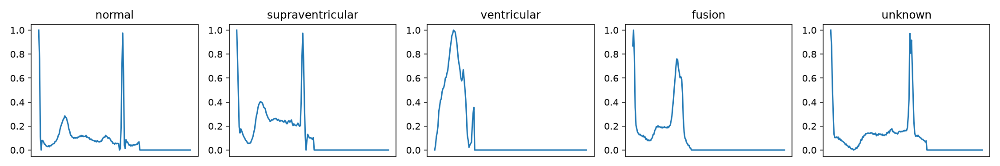
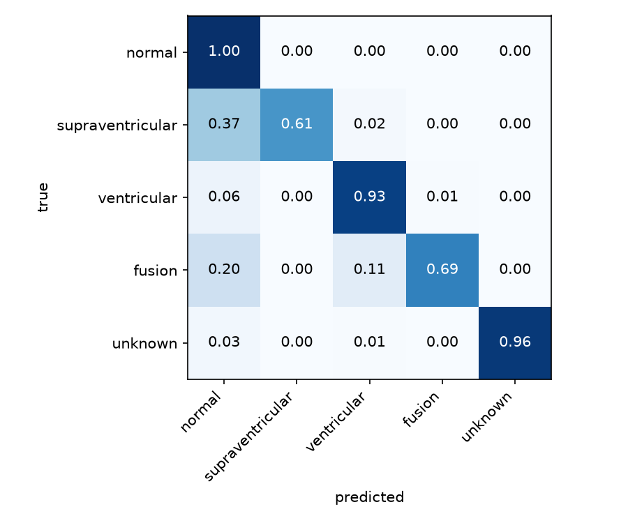
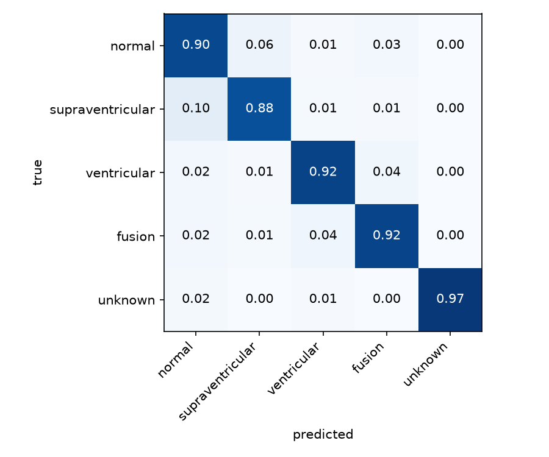

# Heartbeat classifier

A small 1D CNN in PyTorch that sorts ECG heartbeats into 5 classes: normal, supraventricular, ventricular, fusion and unknown. I used the MIT-BIH dataset from Kaggle, where the recordings are already cut into single beats.



About 90% of the beats are normal, so a model can get good accuracy by just saying "normal" every time. Because of that I looked at recall and precision per class, and I trained the model twice: once normally and once with class weights in the loss.

## Results

Without class weights:
```
class               recall  precision   count
normal               0.997      0.980   18118
supraventricular     0.606      0.963     556
ventricular          0.934      0.947    1448
fusion               0.685      0.867     162
unknown              0.963      0.996    1608
accuracy: 0.978
```

With class weights:
```
class               recall  precision   count
normal               0.904      0.992   18118
supraventricular     0.876      0.315     556
ventricular          0.922      0.871    1448
fusion               0.920      0.206     162
unknown              0.965      0.984    1608
accuracy: 0.909
```




Without weights the accuracy is very high, but the model misses a lot of the rare beats: it finds only 61% of the supraventricular ones and 69% of the fusion ones. With weights it finds almost 9 in 10 supraventricular beats and 92% of the fusion ones, but it also labels many normal beats as abnormal, so precision falls to 0.2-0.3 and accuracy goes down to 91%. For heartbeats I'd rather have false alarms than miss an abnormal one, so I prefer the weighted version, even if the weights I used are probably too strong.

The small classes change a bit from run to run (fusion has only 162 beats in the test set), so I fixed the seed to make the two runs comparable.

## How to run

1. `pip install -r requirements.txt`
2. Download the ECG Heartbeat Categorization Dataset from Kaggle and put `mitbih_train.csv` and `mitbih_test.csv` in the `data/` folder
3. Open `src/train.py` and set `USE_WEIGHTS` to `False` (baseline) or `True` (class weights)
4. `python src/train.py`

It trains for 10 epochs and prints the table at the end. It runs fine on CPU, about 3 minutes.

## Project structure

```
src/data.py      loads the csv files
src/model.py     the CNN
src/metrics.py   recall and precision per class
src/train.py     training and evaluation
results/         output of the two runs
```

## Notes

- The Kaggle train/test split is by beat, not by patient, so beats from the same person can end up in both sets. On new patients the score would be lower.
- Next thing I want to try: softer class weights (for example the square root of the ratio) to get a better balance between recall and precision.